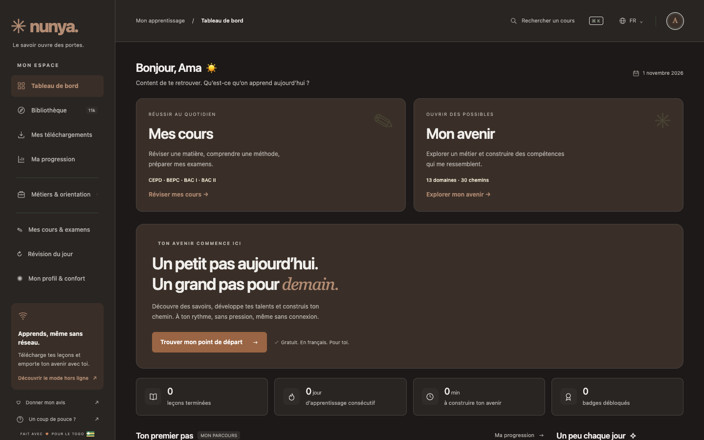
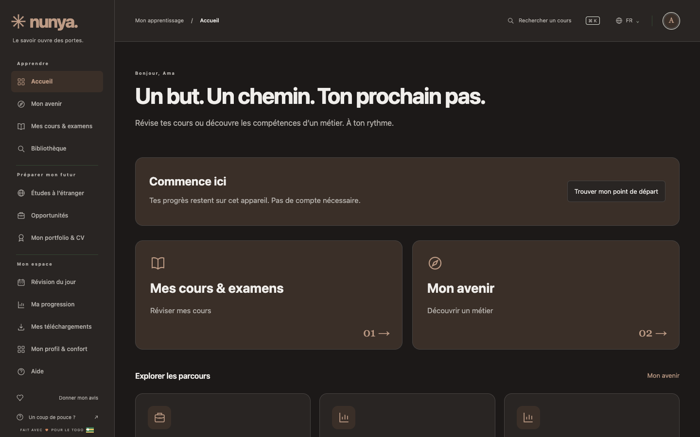
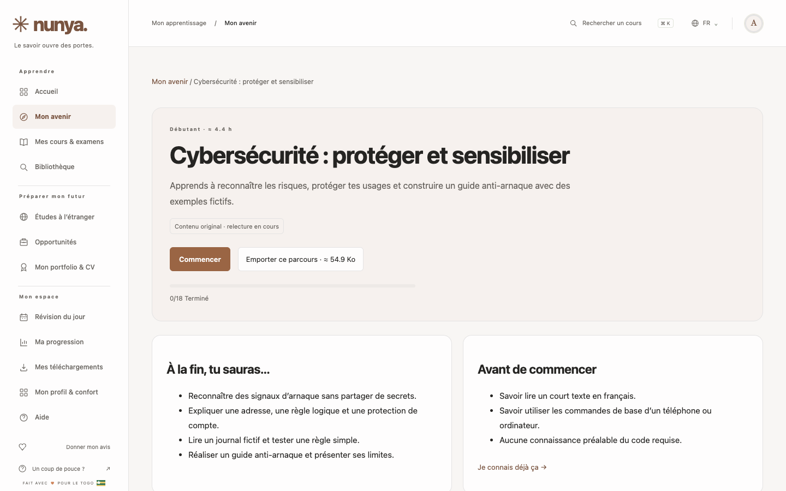
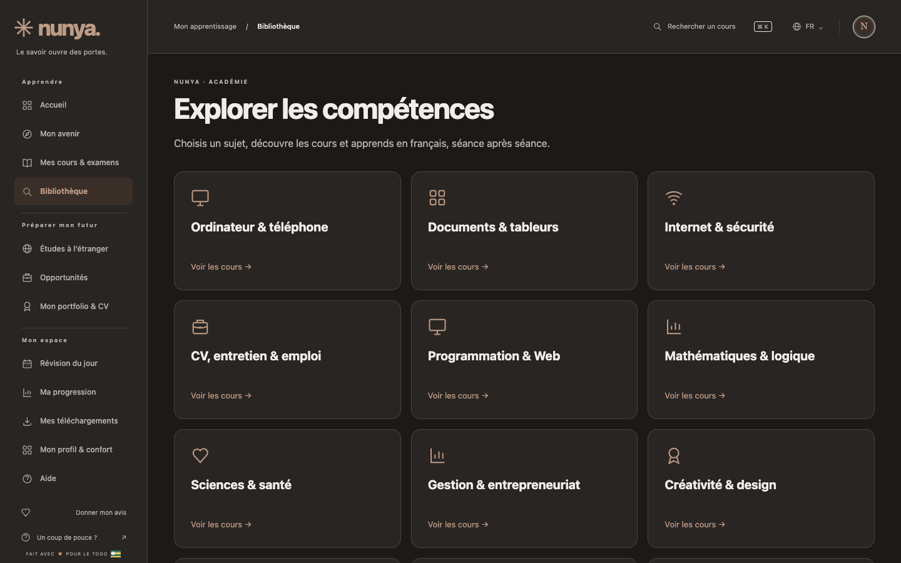

# Audit du prototype 4.0.3 → Académie 5.0.2

Audit initial le 1er novembre, vérification finale le 2 novembre 2026. Application existante conservée. Captures dans `docs/screenshots/`, constats axe bruts dans `AXE_BASELINE.json`, `AXE_FINAL.json` et `AXE_SKILLS.json`.

## P0 — corrigés

- Contraste : axe signalait 21 à 22 éléments de contraste sur l’accueil sombre, et des défauts sur les cours. Les fonds, textes, cartes et états utilisent maintenant la même palette calculée. Tests de contraste des couleurs personnalisées en CI. Les 44 vues finales et 12 vues du nouvel explorateur n’ont aucune violation axe A/AA détectée.
- Navigation : une route canonique détermine l’espace actif, les liens avec `aria-current`, le fil et le titre. Les anciens liens `#/cours` et `#/cours/python` continuent de fonctionner. Navigation mobile à cinq entrées, tiroir et focus au clavier.
- Leçons : les cours s’ouvrent en pages partageables. Lire, Pas à pas et Pratiquer sont au même endroit ; l’éditeur reste contextuel aux leçons de code.
- Démarrage : message français sans JavaScript, guide public statique et écran d’échec si un script manque.

## P1 — livrés

- Accueil orienté objectif et reprise en un clic ; deux entrées cours scolaires / avenir.
- 15 parcours dans 13 domaines, dont trois initiations originales plus approfondies ; les douze autres sont des découvertes, pas des formations professionnelles complètes.
- Bibliothèque à rayons, recherche paginée, 12 compétences, 91 collections ou références identifiées, accompagnements français et vidéos facultatives. Les conditions de réutilisation ne permettent pas l’aspiration ou traduction intégrale de tous les sites demandés.
- 43 métiers documentés, quatre destinations, neuf portes d’entrée d’opportunités, CV et projets locaux.
- Parcours et unité scolaire enregistrables hors ligne ; tests avec réseau coupé dans le navigateur de test.
- Chargement direct des séances ; bundle minifié et JSON différés. JavaScript principal gzip ~122 Ko.

## P2 — limites et suite

- Relecture pédagogique humaine, alignement au programme togolais, admissions et débouchés non validés. Les sources consultées ne sont pas des offres ouvertes garanties.
- Lighthouse mobile local : 80 performance, 100 accessibilité, 100 bonnes pratiques. LCP 4,7 s sur serveur Python sans compression : objectif de moins de 3 s encore à atteindre, puis mesurer sur hébergement réel.
- Aucun essai sur un téléphone Android/iPhone physique. Les lecteurs PDF et chaque vidéo ne sont pas contrôlés individuellement.
- Certains libellés anciens et contenus restent français lors du passage en anglais ; interface de base traduite, pas une traduction intégrale de tous les cours.
- Authentification, IA distante, portfolio public et vrais mentors nécessitent un serveur ; le pilote indique ces fonctions à venir.

## Avant / après

